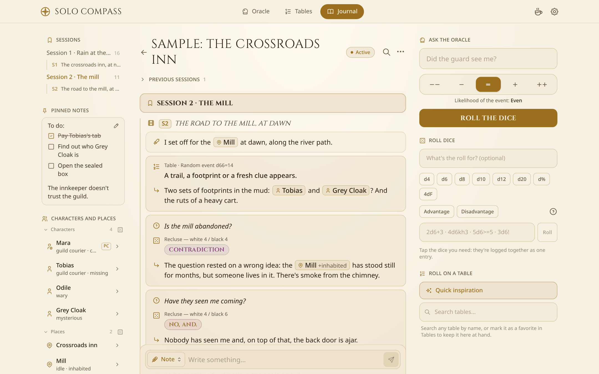
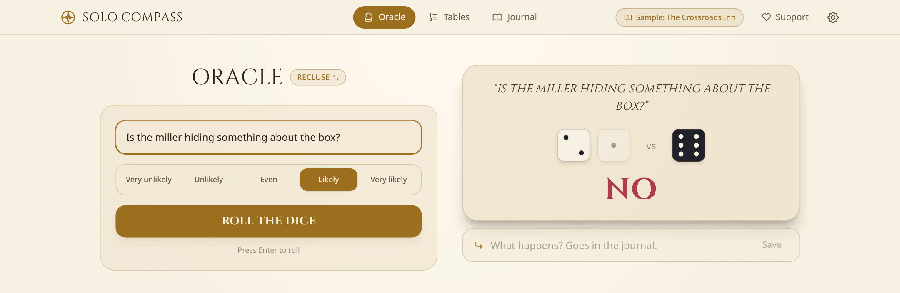
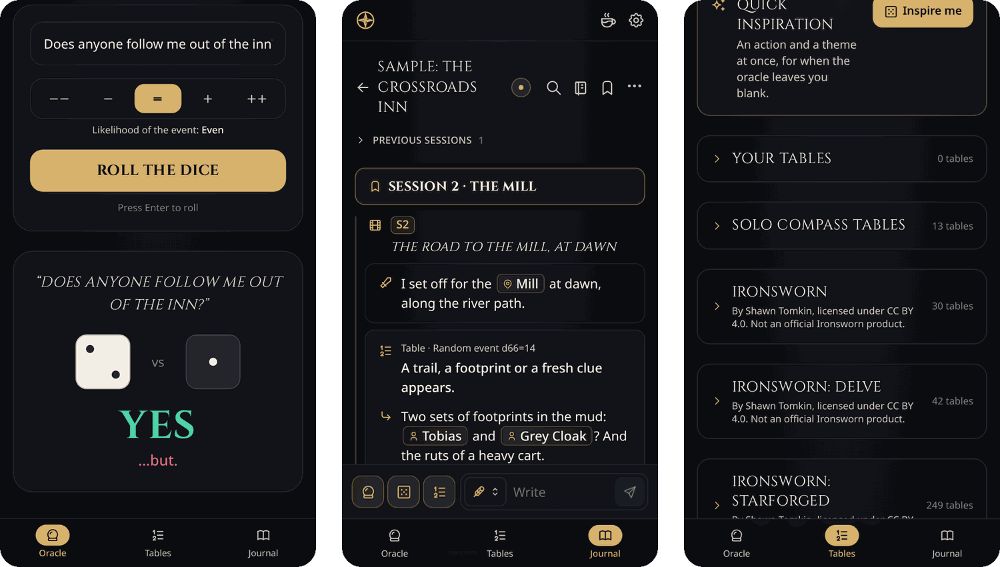
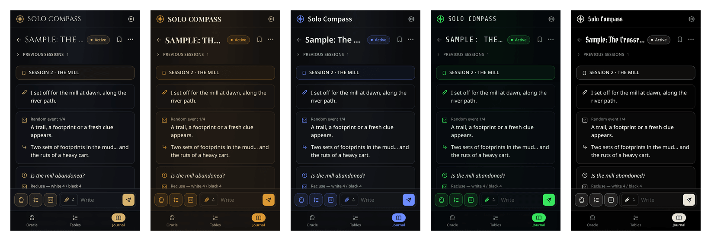

<div align="center">
  
  <h1>Solo Compass</h1>
  <p><strong>A yes/no oracle, meaning tables and a session journal for solo tabletop RPGs, in one app that works offline.</strong></p>
  <p>
    <a href="https://github.com/jgalilea/solo-compass/actions/workflows/deploy.yml"></a>
    <a href="LICENSE"></a>
  </p>
  <p><a href="https://jgalilea.github.io/solo-compass/"><strong>Open the app</strong></a> · <a href="#how-to-play">How to play</a> · <a href="#your-data">Your data</a> · <a href="#development">Development</a></p>
</div>

<picture>
  <source media="(prefers-color-scheme: dark)" srcset="docs/screenshots/workspace-dark.png">
  
</picture>

## Why Solo Compass

Playing an RPG on your own means being both the player and the game master. You ask the oracle, roll on a table for inspiration, and write down what happened. Doing that with paper, dice and a notes app means lots of switching back and forth. Solo Compass puts all three on one screen and keeps the log for you.

- **Ask, roll, write, all in one place.** Every oracle answer and table roll goes straight into the journal of the active adventure. After a roll, the composer switches to "Consequence" so you can write what it means.
- **A real oracle, not a coin flip.** Solo Compass uses [Recluse](https://gravenutterance.itch.io/recluse). Answers have shades ("yes, but…", "no, and…") and contradictions that tell you the question itself was wrong. You can make an event more or less likely.
- **Plain-text journals you own.** Adventures are stored in [Lonelog](https://lonelog.itch.io/lonelog), an open notation for solo play. You can export any adventure as a `.md` file that other Lonelog tools can read, or import one you already have.
- **Works on a phone at the table and on a big screen at your desk.** On a phone the journal is clear of clutter, with the tools in a sheet. On desktop, an adventure becomes a workspace with a session index and a game-table panel.
- **Offline and installable.** It's a PWA: install it from the browser, and it keeps working without a connection.
- **No account and no server.** Everything stays in your browser. The app makes no network requests, has no analytics and needs no sign-up.
- **Five looks, light or dark.** Fantasy, Pulp, Modern, Sci-fi and OSR, each with its own palette and display font.
- **English and Spanish.** The app follows your browser's language by default, and you can switch it in Settings.

## Getting started

There's nothing to install. Open **<https://jgalilea.github.io/solo-compass/>** in any modern browser.

To use it like an app (its own icon, full screen, offline), install it from the browser:

- **Android / Chrome / Edge:** open the browser menu and choose *Install app* (or *Add to Home screen*).
- **iPhone / iPad (Safari):** tap *Share*, then *Add to Home Screen*.

When a new version is out, the app shows an **Update** banner. It never reloads on its own, so nothing you're halfway through typing is lost.

New to solo play? Open **Journal**. While it's empty, it offers a short **sample adventure**, "The Crossroads Inn": two finished sessions that show what a game looks like in the log. You can keep playing it or delete it from its `⋯` menu.

## How to play

### Oracle

<picture>
  <source media="(prefers-color-scheme: dark)" srcset="docs/screenshots/oracle-dark.png">
  
</picture>

Type a yes/no question, pick how likely it is, and roll. The **Recluse** rules (by Graven Utterance, [CC BY 4.0](https://creativecommons.org/licenses/by/4.0/)) work like this:

| Dice | Answer |
|---|---|
| White die higher | **Yes** |
| Black die higher | **No** |
| Both dice 3 or lower | adds **"…but"** |
| Both dice 4 or higher | adds **"…and"** |
| A tie | **Contradiction**: something in the question is wrong, so rethink it |

*Likely* and *Unlikely* add a second die of the favoured colour, and *Very likely* and *Very unlikely* add two. Only the highest die of each colour counts.

When an adventure is active, the question and answer go into its journal, and a small field lets you add the consequence right away. Every roll is also kept in **History**, which you reach from "Recent rolls". There you can filter by oracle, tables or favourites, mark rolls as favourites or delete them.

### Meaning tables

Roll for inspiration when a yes or no isn't enough. Besides its own generic tables, Solo Compass brings nearly 700 tables from open-licensed games, in English and Spanish: **Ironsworn**, **Delve**, **Starforged**, **Starsmith**, **Loner**, **Knave**, **Cairn** and the **Lazy GM's Resource Document**. Each game sits in its own folding block and is only downloaded when you open it. You can also make or import your own. Search them all, star your favourites, and open the full list of results for any table.

### Journal

Create adventures, split them into sessions, and log actions, rolls, consequences and notes; questions come in from the oracle. A question, its roll and the consequences that follow are grouped into one card. Any entry or session title can be edited later. Deleting an entry can be undone straight away.

- Only one adventure is **active** at a time. Rolls go there, and the chip in the header shows which one it is from every screen.
- Inside an adventure, the **game table** gives you the oracle, the tables and a dice roller: d4 to d20, d%, and 4dF for Fate/Fudge. This lets you log rolls from your own system without leaving the app.
- Each adventure has a **notebook** (beside the journal on wide screens, behind the notebook button elsewhere):
  - **Pinned notes** for what you want at hand: inventory, clues, loose ends. They're edited in place, and `- [ ]` lines become checkboxes you can tick.
  - **Characters and places**: name them in any entry with Lonelog tags, like `[N:Odile|wary]`, `[PC:Mara|coins 9]` or `[L:The mill|idle]`. They show as chips in the journal and are gathered in the notebook with their current traits and every entry that mentions them. Changes such as `[N:Odile|+captured|-wary]` or `[PC:Mara|coins-6]` update them. Typing `[` in the journal field suggests the ones you already have, or makes a new one from the name you type, so you don't need to know the syntax. You can also add them, log a change or mention them from the notebook.
- Mark adventures as favourites to keep them at the top, archive the ones you've finished, and search the list.
- **Export** an adventure as Lonelog Markdown, or **import** a `.md` journal. The pinned notes travel in the file's front matter. The import accepts any text: lines it doesn't recognise become notes, so nothing is lost.

<p align="center">
  
</p>

### Themes and language

<p align="center">
  
</p>

In **Settings** (the gear icon) you can choose the theme, light, dark or automatic mode, and the language. These choices are saved on your device.

### Keyboard shortcuts (desktop)

Shortcuts work whenever you aren't typing in a field. Press <kbd>?</kbd> to see the list in Settings.

| Key | Action |
|---|---|
| <kbd>1</kbd> <kbd>2</kbd> <kbd>3</kbd> | Oracle, Tables, Journal (or the active adventure) |
| <kbd>H</kbd> | Roll history |
| <kbd>/</kbd> | Write: the question, search or journal field, depending on the screen |
| <kbd>O</kbd> <kbd>T</kbd> <kbd>D</kbd> | Game-table oracle, tables, dice |
| <kbd>Esc</kbd> | Leave the current field so shortcuts work again |
| <kbd>Enter</kbd> / <kbd>Shift</kbd>+<kbd>Enter</kbd> | Add the journal entry / new line |
| <kbd>?</kbd> | Show the shortcut list |

## Your data

Solo Compass has no server. Your adventures, rolls and settings are stored only in this browser on this device: the journal and history in IndexedDB, small settings in `localStorage`. Nothing syncs between devices or browsers.

There are three ways to keep your data safe, all in **Settings**:

- **Backup:** *Export everything* downloads a single `.json` file with your journal, history and settings. *Restore* loads such a file and replaces what's currently on the device (it asks first).
- **Storage protection:** asks the browser not to clear the app's data when space runs low. It's only requested when you press the button, because some browsers show their own permission prompt.
- **Backup reminder:** a small dot appears on the Settings button only when you've written 10 or more entries since your last backup and it's been at least 14 days. There are no pop-ups.

Clearing the site's data in your browser deletes everything, so export a backup first.

## Development

You need Node.js 22 (the version CI uses) and npm.

```bash
git clone https://github.com/jgalilea/solo-compass.git
cd solo-compass
npm install
npm run dev       # dev server at http://localhost:5173/solo-compass/
```

| Command | What it does |
|---|---|
| `npm run dev` | Vite dev server |
| `npm run build` | Type-check (`tsc -b`) and build to `dist/` |
| `npm run preview` | Serve the production build |
| `npm test` | Vitest unit tests for `src/lib` (oracle, Lonelog import/export, journal grouping, tables, sample adventure, backup reminder) |
| `npm run lint` | oxlint |

The stack is React 19, TypeScript, Vite, Tailwind CSS v4, React Router (`HashRouter`, so it works on GitHub Pages without server rewrites), `idb-keyval` for IndexedDB, `vite-plugin-pwa`, and [Tabler Icons](https://tabler.io/icons).

The UI text lives in `src/lib/i18n/locales/{es,en}.ts`, which share one typed `Dictionary`, so TypeScript flags a missing key. The code comments and commit messages are in Spanish. [`CLAUDE.md`](CLAUDE.md) describes the architecture in more depth: state, storage, theming and responsive layout.

### Deploying

Every push to `main` runs [`.github/workflows/deploy.yml`](.github/workflows/deploy.yml). It installs dependencies, runs the tests, builds the app and publishes `dist/` to GitHub Pages; a failing test stops the deploy. To set this up on a fork:

1. In **Settings → Pages**, set **Source** to **GitHub Actions**.
2. If your repository isn't called `solo-compass`, change `base` in `vite.config.ts` to match.

`npm run deploy` publishes `dist/` to a `gh-pages` branch by hand instead. You don't need it if you use the workflow.

## Credits and license

- **Recluse** oracle by Graven Utterance (Oliver N), [CC BY 4.0](https://creativecommons.org/licenses/by/4.0/): <https://gravenutterance.itch.io/recluse>
- **Lonelog** notation by Roberto Bisceglie, [CC BY-SA 4.0](https://creativecommons.org/licenses/by-sa/4.0/): <https://lonelog.itch.io/lonelog>
- **Tabler Icons**, MIT.
- Solo Compass's own meaning tables are original and written for this app.
- **Ironsworn, Delve and Starforged** oracle tables: this work is based on Ironsworn, Ironsworn: Delve and Ironsworn: Starforged, created by Shawn Tomkin, and licensed for our use under the [Creative Commons Attribution 4.0 International license](https://creativecommons.org/licenses/by/4.0/). Not an official Tomkin Press or Ironsworn product.
- **Starsmith: Expanded Oracles** by Eric Bright, [CC BY 4.0](https://creativecommons.org/licenses/by/4.0/).
- **Loner** v2.3 by Roberto Bisceglie, [CC BY-SA 4.0](https://creativecommons.org/licenses/by-sa/4.0/): <https://zeruhur.itch.io/loner-2nd-edition>
- **Knave** by Ben Milton, [CC BY 4.0](https://creativecommons.org/licenses/by/4.0/): <https://questingbeast.itch.io/knave>
- **Cairn** (second edition) by Yochai Gal, [CC BY-SA 4.0](https://creativecommons.org/licenses/by-sa/4.0/): <https://cairnrpg.com>. English text from its [open source](https://github.com/yochaigal/cairn).
- This work includes material taken from the **Lazy GM's Resource Document** by Michael E. Shea of SlyFlourish.com, available under the [Creative Commons Attribution 4.0 International License](https://creativecommons.org/licenses/by/4.0/). It also includes material from the System Reference Document 5.1 ("SRD 5.1") by Wizards of the Coast LLC, licensed under the same license.
- English text of the Ironsworn family and Starsmith via [Datasworn](https://github.com/rsek/datasworn). The Spanish translations are our own (Ironsworn's with [GatoMalefico's](https://github.com/jesberpen/ironsworn-es-es) as a reference); those of Loner, Starsmith and Cairn are shared under CC BY-SA 4.0.

The Solo Compass code is released under the [GNU General Public License v3.0](LICENSE). You can use, study, change and share it. If you distribute a modified version, you must make its source code available under the same license.

If Solo Compass is useful at your table, you can [support it on Ko-fi](https://ko-fi.com/jgalilea).

<sub>The screenshots show the built-in sample adventure; every name and event in it is fictional.</sub>
