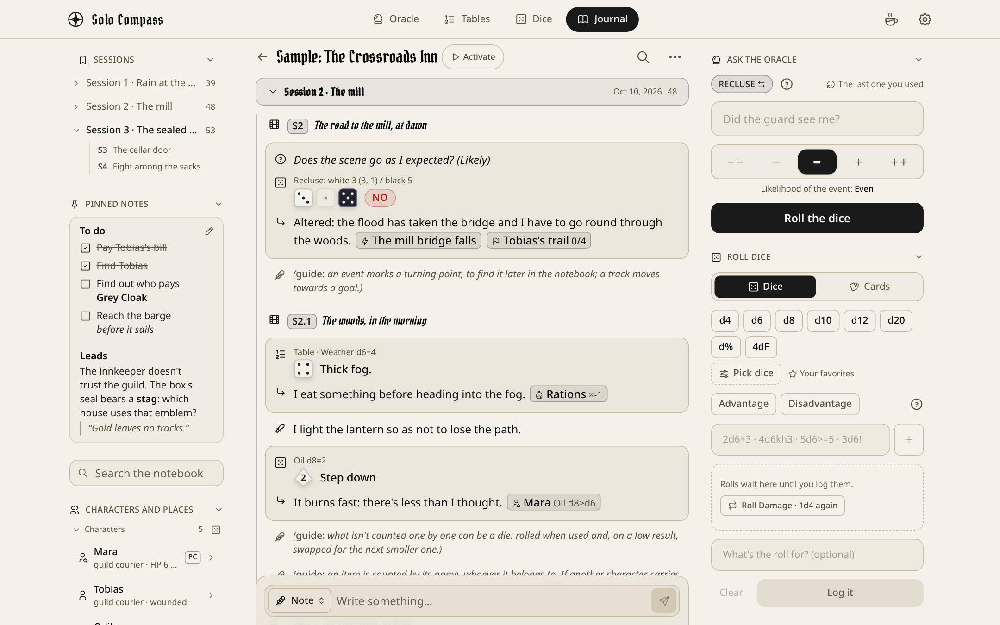
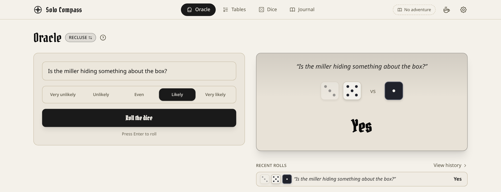
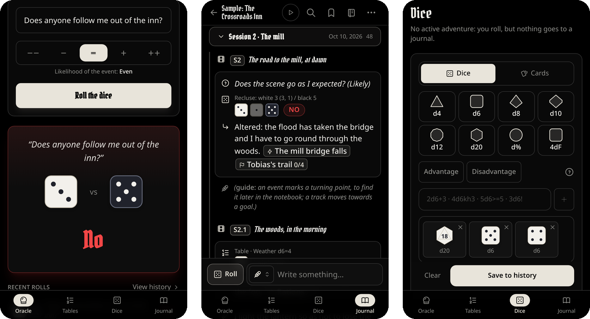
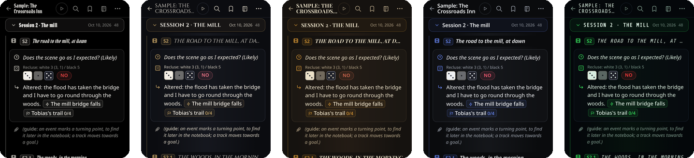

<div align="center">
  
  <h1>Solo Compass</h1>
  <p><strong>A yes/no oracle, meaning tables and a session journal for solo tabletop RPGs, in one app that works offline.</strong></p>
  <p>
    <a href="https://github.com/jgalilea/solo-compass/actions/workflows/deploy.yml"></a>
    <a href="LICENSE"></a>
  </p>
  <p><a href="https://jgalilea.github.io/solo-compass/"><strong>Open the app</strong></a> · <a href="#how-to-play">How to play</a> · <a href="#your-data">Your data</a> · <a href="#development">Development</a></p>
</div>

<picture>
  <source media="(prefers-color-scheme: dark)" srcset="docs/screenshots/workspace-dark.png">
  
</picture>

## Why Solo Compass

Playing an RPG on your own means being both the player and the game master. You ask the oracle, roll on a table for inspiration, and write down what happened. Doing that with paper, dice and a notes app means lots of switching back and forth. Solo Compass puts all three on one screen and keeps the log for you.

- **Ask, roll, write, all in one place.** Every oracle answer and table roll goes straight into the journal of the active adventure. After a roll, the composer switches to "Consequence" so you can write what it means.
- **Four real oracles, not a coin flip.** [Recluse](https://gravenutterance.itch.io/recluse) by default, plus Loner, Ironsworn's "Ask the Oracle" and the One Page Solo Engine. Answers have shades ("yes, but…", "no, and…"), contradictions, twists and extreme results. You can make an event more or less likely, and each oracle's help shows the exact odds.
- **Plain-text journals you own.** Adventures are stored in [Lonelog](https://lonelog.itch.io/lonelog), an open notation for solo play. You can export any adventure as a `.md` file that other Lonelog tools can read, or import one you already have.
- **Works on a phone at the table and on a big screen at your desk.** On a phone the journal is clear of clutter, with the tools in a sheet. On desktop, an adventure becomes a workspace with a session index and a game-table panel.
- **Offline and installable.** It's a PWA: install it from the browser, and it keeps working without a connection.
- **On all your devices, if you want.** Turn on sync and a code links your phone and your computer: the same journal on both, kept up to date by itself, end-to-end encrypted and with no account. [How it works](#device-sync).
- **No account, and your journal stays yours.** Everything is kept in your browser, with no analytics and no sign-up. The only request the app makes beyond its own site is the optional device sync, encrypted on your device before it leaves.
- **Five looks, light or dark.** OSR is the main one, plus Fantasy, Pulp, Modern and Sci-fi, each with its own palette and display font.
- **English and Spanish.** The app follows your browser's language by default, and you can switch it in Settings.

## Getting started

There's nothing to install. Open **<https://jgalilea.github.io/solo-compass/>** in any modern browser.

To use it like an app (its own icon, full screen, offline), install it from the browser:

- **Android / Chrome / Edge:** open the browser menu and choose *Install app* (or *Add to Home screen*).
- **iPhone / iPad (Safari):** tap *Share*, then *Add to Home Screen*.

On iPhone and iPad this matters more than elsewhere: Safari deletes a site's data after a week of use without visiting it, while an installed app keeps it. The installed app also starts empty, because iOS keeps its storage apart from Safari's, so if you've already played in Safari, carry your games over with a backup (see [Your data](#your-data)). The journal reminds you of this when you open it from Safari.

When a new version is out, the app shows an **Update** banner. It never reloads on its own, so nothing you're halfway through typing is lost.

New to solo play? Open **Journal**. While it's empty, it offers a short **sample adventure**, "The Crossroads Inn": two finished sessions that show what a game looks like in the log. You can keep playing it or delete it from its `⋯` menu.

## How to play

### Oracle

<picture>
  <source media="(prefers-color-scheme: dark)" srcset="docs/screenshots/oracle-dark.png">
  
</picture>

Type a yes/no question, pick how likely it is, and roll. The **Recluse** rules (by Graven Utterance, [CC BY 4.0](https://creativecommons.org/licenses/by/4.0/)) work like this:

| Dice | Answer |
|---|---|
| White die higher | **Yes** |
| Black die higher | **No** |
| Both dice 3 or lower | adds **"…but"** |
| Both dice 4 or higher | adds **"…and"** |
| A tie | **Contradiction**: something in the question is wrong, so rethink it |

*Likely* and *Unlikely* add a second die of the favoured colour, and *Very likely* and *Very unlikely* add two. Only the highest die of each colour counts.

The oracle's name next to the title switches to another one. Each adventure remembers the one you play it with, and a star marks your favorite, which new adventures start with:

| Oracle | How it answers |
|---|---|
| **Loner** (Roberto Bisceglie, CC BY-SA 4.0) | A Chance die against a Risk die, like Recluse. Advantage or disadvantage adds one die. A tie is "Yes, but…" and counts toward a twist: the third double rolls Loner's twist tables. |
| **Ironsworn**, "Ask the Oracle" (Shawn Tomkin, CC BY 4.0) | One d100: yes from 11, 26, 51, 76 or 91 up, depending on the likelihood. Matching digits (11, 22… 100) mean an extreme result or a twist. |
| **One Page Solo Engine** v1.6 (Karl Hendricks, CC BY-SA 4.0) | An answer d6 (yes on 3+, 4+ or 5+) and a modifier d6 (1 adds "but", 6 adds "and"). |

Each oracle's **?** explains its rules in a few lines and has a table with the exact chance of each answer at every likelihood, worked out from every possible roll.

When an adventure is active, the question and answer go into its journal, and a small field lets you add the consequence right away. Every roll is also kept in **History**, which you reach from "Recent rolls". There you can search, filter by oracle, tables, dice, favourites or adventure, log a free roll in a journal, mark rolls as favourites or delete them.

### Meaning tables

Roll for inspiration when a yes or no isn't enough. Besides its own generic tables, Solo Compass brings over 750 tables from open-licensed games, in English and Spanish: **Ironsworn**, **Delve**, **Ironsmith**, **Starforged**, **Starsmith**, **Loner**, **Knave**, **Cairn**, the **Lazy GM's Resource Document** and the One Page Solo Engine's "How much?". Each game sits in its own folding block and is only downloaded when you open it. You can also make or import your own. Search by name, game or theme, or switch on searching the results too ("which table had a lighthouse?"). Results that say "Roll twice" roll again by themselves, and in your own tables `{Table name}` rolls on another table. Search them all, star your favourites, and open the full list of results for any table.

### Journal

Create adventures, split them into sessions and scenes, and log actions, rolls, consequences and notes; questions come in from the oracle. A question, its roll and the consequences that follow are grouped into one card. Any entry or session title can be edited later. Deleting an entry can be undone straight away.

- Only one adventure is **active** at a time. Rolls go there, and the chip in the header shows which one it is from every screen.
- Inside an adventure, the **game table** gives you the oracle, the tables and a dice roller: d4 to d20, d%, d66 (as two d6; a die of 66 sides is `d(66)`), 4dF for Fate/Fudge, advantage and disadvantage, and typed formulas such as `2d6+3`, `4d6kh3` or `4d6dl1` (keep the highest three), `5d6>=5` (count successes, `f<3` to subtract failures), `3d6!` and `d6!!` (exploding and compounding) or `4d6dl1 // Strength` (with a description), and a deck of cards or a tarot. This lets you log rolls from your own system without leaving the app. Each adventure keeps its own dice and tables at hand there (your favorites until you pick others).
- Each adventure has a **notebook** (beside the journal on wide screens, behind the notebook button elsewhere):
  - **Pinned notes** for what you want at hand: inventory, clues, loose ends. They're edited in place and take everyday Markdown (bold, italic, headings, lists, quotes, links), with `- [ ]` lines as checkboxes you can tick. Each character's and place's description takes the same.
  - **Characters and places**: name them in any entry with Lonelog tags, like `[N:Odile|wary]`, `[PC:Mara|coins 9]` or `[L:The mill|idle]`. They show as chips in the journal and are gathered in the notebook with their current traits and every entry that mentions them. Changes such as `[N:Odile|captured|-wary]` or `[PC:Mara|coins-6]` update them. Typing `[` in the journal field (or while editing an entry) suggests the ones you already have, or makes a new one from the name you type, so you don't need to know the syntax. You can also add them, log a change or mention them from the notebook.
  - **Threads, clocks and events**: open plot threads (`[Thread:The sealed box|Open]`), threat clocks (`[Clock:Alarm 2/6]`), tracks (`[Track:Escape 3/8]`) and timers (`[Timer:Dawn 3]`), ticked up or down with a tap, and the turning points (`[E:The bridge falls]`). A die beside Characters, Places and Threads **rolls on the list** to pick one at random.
  - **Rooms, foes and inventory**, from Lonelog's official add-ons: dungeon rooms (`[R:4|status:cleared|library|exits:N R2]`), foes in a fight (`[F:Thug A|HP 6|pos:Close]`, struck through once dead or fled), items (`[Inv:Torch|×3]`) and money (`[Wealth:Mara|Gold 45]`), decks (`[Deck:Main|×52]`), with −/+ to use one up or gain one.
- The journal reads all of **Lonelog 1.7** (and everything earlier versions wrote): scenes inside sessions (`S1 *Tavern, night*`, numbered for you from "New scene"; flashbacks `S5a`, montages `S7.1`, parallel storylines `T2-S1 *City* @(Jordan)`), tables and generators (`tbl:`), answers (`-> Yes, but…`, `-> Yb`), the compact one-line form (`@Sneak d:2<4 ->F => noise`), other characters acting (`@(Jonah) …`), dialogue, `(note: …)` asides, `\---` in-world text and the add-ons' `[COMBAT]` blocks with `Rd1` rounds. Each is drawn as what it is, and written back as it was; your own rolls come out in Lonelog's order (`d: Attack d20+5[14]=19`).
- Mark adventures as favourites to keep them at the top, archive the ones you've finished, and search the list. When a campaign turns a page, **carry on in a new adventure**: a blank journal with the notebook just as it was.
- **Zen mode** reads an adventure as a story: only what's told, without the questions, the rolls or the game table.
- **Search** the journal (or all of them) by words and by type of entry.
- **Statistics**, for the fun of it: an adventure's sessions and roughly how long each was played, its year in a heat map, who and where is named most, the oracle against its odds and the luck of your dice, with a chart per kind of die. The journal list tells the luck of your dice across all your adventures.
- Rolls are **drawn**: each die with its shape and what came up, and each card with its suit. What's stored and exported is still plain Lonelog text.
- **Export** an adventure as Lonelog Markdown or as a self-contained **web page** in the current theme (to read, share or print), or **import** a `.md` journal. The pinned notes travel in the file's front matter. The import accepts any text: lines it doesn't recognise become notes, so nothing is lost. A journal, a table or a backup can also be dropped onto the window, opened with the installed app ("Open with" on a computer) or shared to it (Android's share sheet); the app says what the file is and asks before keeping anything, and refuses what isn't its own.

<p align="center">
  
</p>

#### What's used of Lonelog, and what isn't

| Used (Lonelog 1.7.0) | Left apart, on purpose |
|---|---|
| **Core**, all of it, and the forms earlier versions wrote | **Partylog**: group play (`!`, `[Party:]`) |
| **Combat** 1.2: `[COMBAT]`, `Rd1`, `[F:]` | **Lorelog** (a draft): facts and lore of the world |
| **Dungeon Crawling** 1.2: `[R:]`, `[DUNGEON STATUS]` | **Maplog** (a draft): drawing maps |
| **Resource Tracking** 1.2: `[Inv:]`, `[Wealth:]`, `[RESOURCES]` | **Solo Wargaming**: `[Unit:]`, `[Force:]`, `[Scenario:]` |
| **Dice Notation** 1.1 and **Card Notation** 1.1 (`[Deck:]`) | |

A journal that has any of the latter loses nothing: what is theirs stays as text and is exported the same, but the notebook doesn't gather or count it.

### Themes and language

<p align="center">
  
</p>

In **Settings** (the gear icon) you can choose the theme, light, dark or automatic mode, and the language. These choices are saved on your device.

### Keyboard shortcuts (desktop)

Shortcuts work whenever you aren't typing in a field. Press <kbd>?</kbd> to see the list in Settings.

| Key | Action |
|---|---|
| <kbd>1</kbd> <kbd>2</kbd> <kbd>3</kbd> <kbd>4</kbd> | Oracle, Tables, Dice, Journal (or the active adventure) |
| <kbd>H</kbd> | Roll history |
| <kbd>/</kbd> | Write: the question, search or journal field, depending on the screen |
| <kbd>O</kbd> <kbd>T</kbd> <kbd>D</kbd> | Game-table oracle, tables, dice |
| <kbd>Esc</kbd> | Leave the current field so shortcuts work again |
| <kbd>Enter</kbd> / <kbd>Shift</kbd>+<kbd>Enter</kbd> | Add the journal entry / new line |
| <kbd>?</kbd> | Show the shortcut list |

## Your data

Your adventures, rolls and settings are stored in this browser on this device: the journal and history in IndexedDB, small settings in `localStorage`. There's no account and nothing leaves the device unless you take it out, or turn on device sync.

### Device sync

**Sync your devices** (Settings → Your data) keeps the same journal on your phone and your computer, up to date by itself. It's optional and off until you turn it on.

**How to use it.** On the device that has your journal, press *Turn on for this device*. You get a sync code with a QR code: keep it somewhere safe (a password manager, a private note) or download it, since it's the only key to your synced data. On the other device, go to the same card and press *Scan the QR code* (the camera opens inside the app), or *I have a code* to type or paste it (a typo is caught before anything happens); the system camera works too, since the QR code is a link that opens the app. It always asks before linking, and what each device had is joined, losing nothing. On an iPhone or iPad with the app installed, paste the code inside the app: the QR code opens Safari, which keeps its data apart. Any number of devices can share one code.

**When it syncs.** When the app opens, always; when you come back to it after half a minute in another app or window (and, on a computer, on the first click after five minutes without touching it); three minutes after your last change (a quarter of an hour at most while you keep playing); when you leave the app or close the tab (the change is prepared and sealed a moment after it's made, so leaving only sends it, and it arrives even if the page closes right then); when the connection comes back; and with *Sync now*. Changes are gathered and nothing is asked for no reason, since the relay's free daily allowance is shared by everyone: two hours of steady play cost about eight requests. Offline you play as usual and changes go out later. If the same thing changes on two devices, the most recent edit wins (by each device's clock; the app warns if a clock is off), and deletions are remembered for a year so they don't come back from another device. A cloud icon beside Settings shows at a glance how it's going (synced, sending, changes waiting, offline or paused, something to look at) and opens the details.

**What travels.** Your adventures (journal, pinned notes, descriptions, game table), the roll history, your own tables, dice and generators, and what you delete. Each device's settings don't: theme, mode, language, favorites, the order of your adventures, the active one, card shuffles and unsent drafts.

**Security.** The code is 128 random bits made on your device. From it the app derives (HKDF-SHA-256), separately, the box's id on the relay, its password and an AES-256-GCM key. Everything is compressed and encrypted on the device before it leaves, over HTTPS, and each sealed part is authenticated, so anything altered is rejected. The code itself is never sent: the relay keeps only a SHA-256 hash of the password, and the QR code's link carries the code after `#`, which browsers don't send to servers. Whoever has the code can read and change the synced journal, so *Change the code* moves to a new one and deletes the old copy. Without the code the relay's copy can't be decrypted by anyone, the maintainer included.

**Privacy and data use.** There's no account, email or name: each code is an anonymous box. For each box the relay keeps the encrypted data (each change with the time it came in), the password's hash, its size and when it expires; it doesn't store IP addresses or browser details. Like any website, the connection itself shows your IP address and browser to the relay and to Cloudflare, which hosts it on its free plan and handles that connection data under [its privacy policy](https://www.cloudflare.com/privacypolicy/). Nothing is used for ads or analytics or shared with anyone. The relay's code is in [`relay/`](relay/).

**Limits and retention.** A box holds up to 24 MB, compressed and encrypted (many years of play), with changes folded into one snapshot as they pile up. A box nobody uses for six months is deleted by itself (a device back later starts a new one with everything it has); *Delete the server's copy* deletes it at once, and *Stop syncing here* only unlinks one device. The relay runs on Cloudflare's free plan: if its daily allowance runs out or it doesn't answer, sync pauses, says until when at the latest (midnight UTC), suggests carrying changes by hand with *Send* and *Merge* meanwhile, and resumes by itself. Nothing is ever charged and nothing is lost.

**It isn't a backup.** A deletion or a mistake syncs too, so keep exporting backups now and then.

### Keeping your data safe

There are three more ways to keep your data safe, all in **Settings**:

- **Backup:** *Export everything* downloads a single `.json` file with your journal, history and settings; *Send* hands it straight to another device or app through your system's share menu. *Restore* loads such a file and asks whether to **merge** it with what's on this device (to carry a game between your phone and your computer: what's new on either side is kept, the latest change wins and deletions stay deleted) or to **replace** everything.
- **Storage protection:** asks the browser not to clear the app's data when space runs low. It's only requested when you press the button, because some browsers show their own permission prompt.
- **Backup reminder:** a small dot appears on the Settings button only when you've written 10 or more entries since your last backup and it's been at least 14 days. There are no pop-ups.

On iPhone and iPad, install the app rather than playing in Safari, which clears a site's data after a week of use without visiting it (see [Getting started](#getting-started)).

Clearing the site's data in your browser deletes everything, so export a backup first.

## Development

You need Node.js 24 (the version CI uses) and npm.

```bash
git clone https://github.com/jgalilea/solo-compass.git
cd solo-compass
npm install
npm run dev       # dev server at http://localhost:5173/solo-compass/
```

The browser tests need Playwright's Chromium once: `npx playwright install chromium`.

| Command | What it does |
|---|---|
| `npm run dev` | Vite dev server |
| `npm run build` | Type-check (`tsc -b`) and build to `dist/` |
| `npm run preview` | Serve the production build |
| `npm test` | Vitest unit tests for `src/lib` (oracles and their odds, Lonelog import/export, tags, dice formulas, journal grouping, tables, sample adventure, backup, device sync) and the sync relay (`relay/src`) |
| `npm run test:e2e` | Builds, then plays the main path (oracle, an adventure, an entry and a scene, a table roll, a reload) with Playwright on a phone and a desktop viewport; also Lonelog and backups in and out, files dropped or shared to the app, two devices syncing through a fake relay (when the build has one), and an axe accessibility check (WCAG 2.1 AA) in every theme and mode |
| `npm run test:perf` | Restores years of synthetic play (11,000 entries, 10,000 rolls) and times the main screens on a phone with a slowed-down CPU. Not part of the deploy |
| `npm run lint` | oxlint |

The stack is React 19, TypeScript, Vite, Tailwind CSS v4, React Router (`HashRouter`, so it works on GitHub Pages without server rewrites), `idb-keyval` for IndexedDB, `vite-plugin-pwa`, and [Tabler Icons](https://tabler.io/icons).

The UI text lives in `src/lib/i18n/locales/{es,en}.ts`, which share one typed `Dictionary`, so TypeScript flags a missing key. The UI is Spanish first; the code comments, test names and commit messages are in English. [`CLAUDE.md`](CLAUDE.md) describes the architecture in more depth: state, storage, theming and responsive layout.

### Deploying

Every push to `main` runs [`.github/workflows/deploy.yml`](.github/workflows/deploy.yml). It installs dependencies, runs the unit tests, builds the app, runs the Playwright smoke test against the build and publishes `dist/` to GitHub Pages; any failure stops the deploy. To set this up on a fork:

1. In **Settings → Pages**, set **Source** to **GitHub Actions**.
2. If your repository isn't called `solo-compass`, change `base` in `vite.config.ts` to match.

`npm run deploy` publishes `dist/` to a `gh-pages` branch by hand instead. You don't need it if you use the workflow.

Device sync needs its relay deployed once on Cloudflare's free plan (steps in [`relay/README.md`](relay/README.md)) and its URL in `.env` (`VITE_SYNC_RELAY_URL`). With it empty, the build simply doesn't offer sync.

## Credits and license

- **Recluse** oracle by Graven Utterance (Oliver N), [CC BY 4.0](https://creativecommons.org/licenses/by/4.0/): <https://gravenutterance.itch.io/recluse>
- **One Page Solo Engine** v1.6 oracle and its "How much?" table by Karl Hendricks (Inflatable Studios), [CC BY-SA 4.0](https://creativecommons.org/licenses/by-sa/4.0/): <https://inflatablestudios.itch.io/one-page-solo-engine>. Loner's and Ironsworn's oracles are credited below with their tables.
- **Lonelog** notation by Roberto Bisceglie, [CC BY-SA 4.0](https://creativecommons.org/licenses/by-sa/4.0/): <https://lonelog.itch.io/lonelog>
- **Tabler Icons**, MIT.
- Solo Compass's own meaning tables are original and written for this app.
- **Ironsworn, Delve and Starforged** oracle tables: this work is based on Ironsworn, Ironsworn: Delve and Ironsworn: Starforged, created by Shawn Tomkin, and licensed for our use under the [Creative Commons Attribution 4.0 International license](https://creativecommons.org/licenses/by/4.0/). Not an official Tomkin Press or Ironsworn product.
- **Ironsmith** by Eric Bright, [CC BY 4.0](https://creativecommons.org/licenses/by/4.0/).
- **Starsmith: Expanded Oracles** by Eric Bright, [CC BY 4.0](https://creativecommons.org/licenses/by/4.0/).
- **Loner** v2.3 by Roberto Bisceglie, [CC BY-SA 4.0](https://creativecommons.org/licenses/by-sa/4.0/): <https://zeruhur.itch.io/loner>
- **Knave** by Ben Milton, [CC BY 4.0](https://creativecommons.org/licenses/by/4.0/): <https://questingbeast.itch.io/knave>
- **Cairn** (second edition) by Yochai Gal, [CC BY-SA 4.0](https://creativecommons.org/licenses/by-sa/4.0/): <https://cairnrpg.com>. English text from its [open source](https://github.com/yochaigal/cairn).
- This work includes material taken from the **Lazy GM's Resource Document** by Michael E. Shea of SlyFlourish.com, available under the [Creative Commons Attribution 4.0 International License](https://creativecommons.org/licenses/by/4.0/). It also includes material from the System Reference Document 5.1 ("SRD 5.1") by Wizards of the Coast LLC, licensed under the same license.
- English text of the Ironsworn family, Ironsmith and Starsmith via [Datasworn](https://github.com/rsek/datasworn). The Spanish translations are our own (Ironsworn's with [GatoMalefico's](https://github.com/jesberpen/ironsworn-es-es) as a reference); those of Loner, Ironsmith, Starsmith, Cairn and the One Page Solo Engine are shared under CC BY-SA 4.0.

Solo Compass is an independent, unofficial project: it isn't an official product of, nor affiliated with, endorsed or sponsored by, any of the authors, publishers or games credited above (including Tomkin Press and Ironsworn).

The Solo Compass code is released under the [GNU General Public License v3.0](LICENSE). You can use, study, change and share it. If you distribute a modified version, you must make its source code available under the same license.

If Solo Compass is useful at your table, you can [support it on Ko-fi](https://ko-fi.com/jgalilea).

<sub>The screenshots show the built-in sample adventure; every name and event in it is fictional.</sub>
